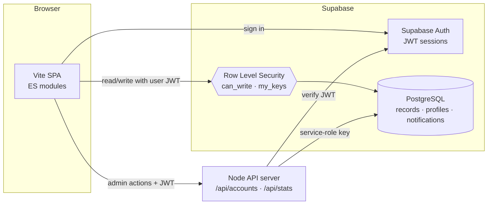

# Architecture

## Front end (`src/`)
- **Single-page app**, hash-based routing (`#/Leave Application/My Applications`), so it works on any static host.
- `state.js` holds the shared state. `app/registry.js` holds the page, home and form registries that feature modules fill in.
- **Progressive disclosure:** home screens show task rows only. Detail opens in pages, tabs (sections) or modals.
- **Data layer (`lib/store.js`):** on sign-in it loads every row the user may see (RLS filters on the server). Each change is diffed against the last synced snapshot and only changed rows are sent (insert / update / delete). On any error it reloads from the server, so the screen never shows unsaved data. It refreshes every 60 seconds and when the tab regains focus.
- **Permissions in the UI** (`lib/permissions.js`) only decide what to *show*. The database decides what is *allowed*.

## Database (`supabase/migrations`)
| Table | Purpose |
|---|---|
| `profiles` | One row per sign-in account: `login_id` (ST-1001), `role`, `person_id` |
| `records` | Campus data as JSON documents: `(collection, key)` primary key, `student_id` for ownership |
| `notifications` | Audience-addressed messages (`{student:1}`, `{position:Librarian}`, `{all}`), `read_by`, `handled` |

**Why a document table?** Campus processes change often (new request types, new positions). A typed `collection + jsonb` model lets features evolve without migrations, while `student_id` and `collection` remain real columns for security and indexing. Hot paths are indexed (`collection`, `student_id`, GIN on `audience`). Unique partial indexes enforce business rules, such as one lab seat per person per day.

**Security functions:** `app_role()`, `app_person()`, `app_positions()`, `my_keys()`, `can_write(collection, key, student_id, data, op)`. Every policy delegates to them, so the rules live in one place.

## API server (`server/`)
Only for operations the browser must never do with its public key:
- create, reset and delete sign-in accounts (Supabase Admin API, service-role key)
- aggregate stats

Each request: rate limit → verify the user's JWT with Supabase → load profile → check role → validate input → act → audit log line.

## Key flows
**Leave:** student inserts `leaves` (status must be *Pending*, enforced by RLS) and notifies `role:Principal`/`role:Vice Principal` → the leader updates the status → the student is notified (and `position:Academic Assistant` too, if clearance is required) → the Academic Assistant records clearance, optionally writing explicit *On Leave* attendance rows.

**Lab pass:** `lab_seats(date)` RPC shows occupancy without exposing names. Unique indexes make double-booking impossible, even with two simultaneous clicks.
